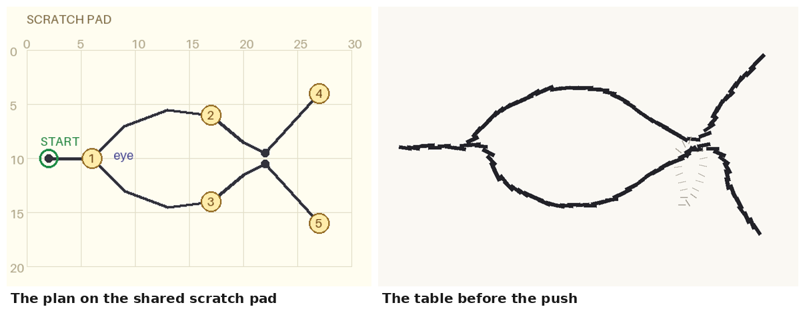
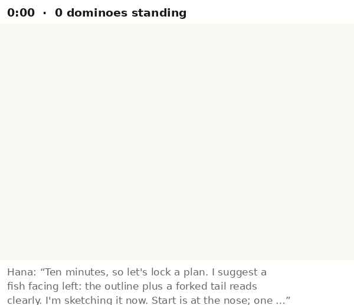
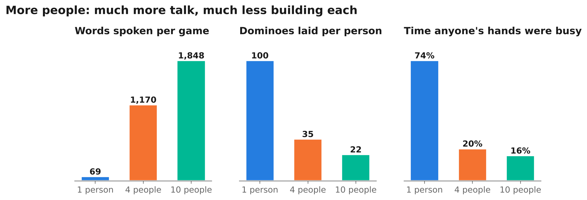
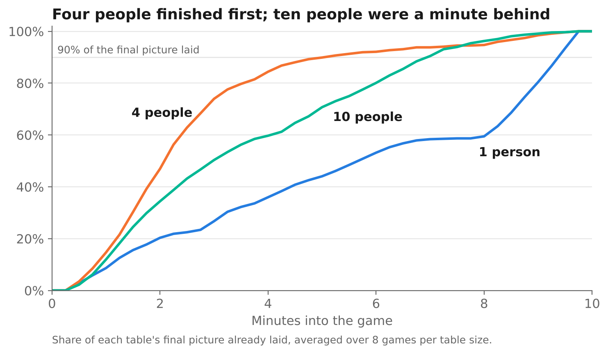
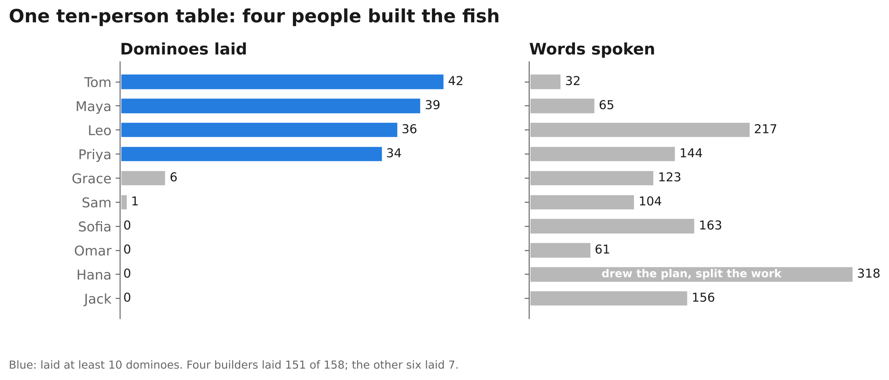
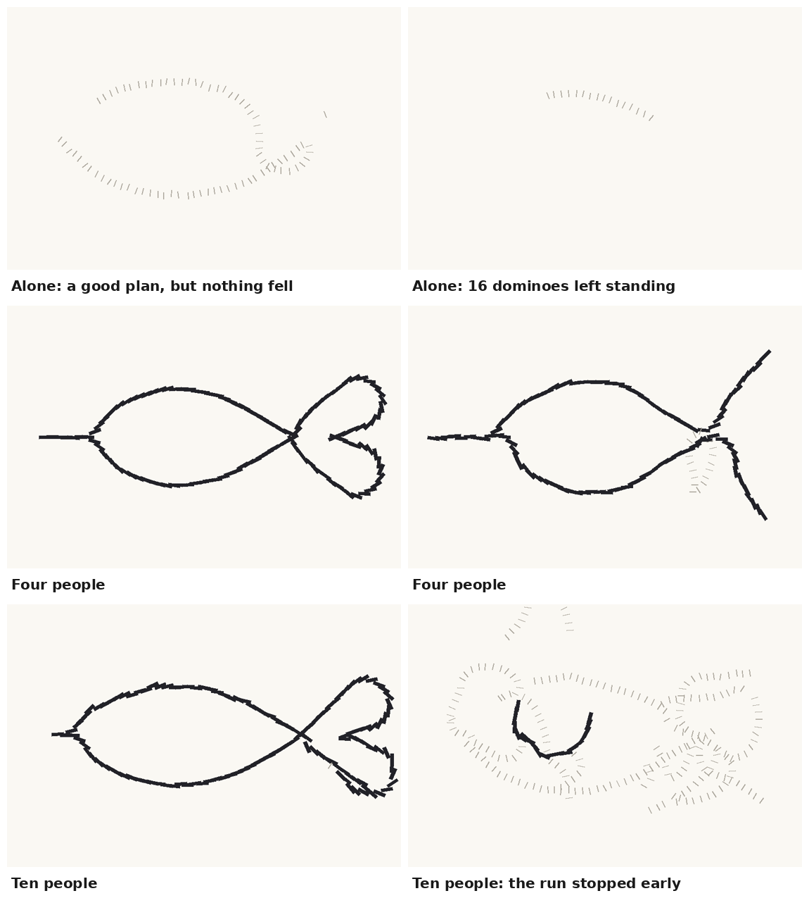

# Ten people, ten minutes, one fish: simulating an overstaffed team with AI agents

*Part 1 of a series on organizational health, run as experiments with AI agents.
Code: [github.com/lilipads/org-sim](https://github.com/lilipads/org-sim)*

Most of what we believe about how teams work comes from anecdote: a project that went well, a reorg that
didn't, a meeting that should have been an email. Anecdotes are hard to argue with and impossible to
rerun. You can't take the same team, change one thing, and play the quarter again.

With AI agents you can. This series uses a small simulator in which AI agents work together on a shared
physical task under a clock. Each experiment changes one thing about the organization and replays the game
many times. Part 1 asks the oldest question: what happens when you put more people on a job?

## The game

Each table gets **ten minutes to make a picture of an animal out of dominoes**. When time is up, a
facilitator pushes the start domino. The picture is whatever falls; anything still standing is
invisible. Three blind judges look only at the fallen dominoes and guess the animal.

It's a small game with the shape of real work:

- **A vision has to be agreed.** Which animal, which way it faces, where the run starts.
- **The work can be split.** Different people can lay different lines at once, like engineers on
  different parts of a system.
- **Everything has to join up.** A beautiful tail the run never reaches doesn't fall, so it doesn't count.
  Integration is where most pictures die.
- **Talking costs time.** Only one person holds the floor at a time, and while you talk, your hands slow
  down.


*Left: a team's plan on the shared scratch pad, five numbered strokes from START. Right: the table
just before the push.*

## How the simulator works

The point of the simulator is to keep the agents' behaviour free while making the world they act in
realistic and measurable.

- **Agents.** Each player is a language-model agent with a short personality ("patient and precise with
  fiddly work", "upbeat and full of ideas"). No job titles, no assigned roles. Anyone can lead, follow,
  plan, build, check, or hover.
- **A real-time clock.** The game advances in 15-second beats. An agent is woken when something calls for
  its attention, like someone speaking to it, its hands finishing a job, a facilitator calling time, or a
  bump at the table. Each time it decides what to say, to whom, how eagerly, and what to do with its hands.
- **Talk is a shared, scarce channel.** When several people want to speak, the most eager gets the floor
  and the others hold their thought. Words cost time, and talking slows your hands.
- **Hands are realistic.** Each agent has its own speed and steadiness. Dominoes land slightly off where
  they were aimed. Physics decides whether a falling domino knocks over the next one: it has to be close,
  in line, and not around too sharp a corner. Working right next to someone occasionally bumps the table.
- **A shared scratch pad.** Anyone can pick it up and sketch the plan as numbered strokes. Builders then
  "trace" a stroke with their own hands, so the picture is only as good as the plan and the building.
- **Eyes, not rulers.** Agents see the table as a picture, with dominoes that the start would knock over
  drawn darker than those it wouldn't reach. They can point at spots, inspect an area closely, fix small
  breaks, or lift and re-lay a section.
- **Independent judging.** Three blind judges name the animal from the fallen picture. Nobody is told how
  they'll be judged beyond "the judges see what falls".

Every message, every domino and every decision is logged, so each game can be replayed, counted and
read as a story.


*A ten-person game: the build, one frame every 15 seconds with a line of what was said, then the push.*

## The experiment

Tables of **1, 4 and 10** agents, with everything else identical: the same 30 × 20 table, the same 250
dominoes, the same scratch pad, the same ten minutes. Eight games per table size with different seeds
and personalities, all played by the same model. That's 24 games in total.

## What happened

Every table chose a fish. Here's how one ten-person table got going:

> **Hana:** Ten minutes, so let's lock a plan. I suggest a fish facing left: the outline plus a forked tail
> reads clearly. I'm sketching it now. Start is at the nose; one line goes over the top, one under the belly,
> and both meet at the tail. Maya, can you trace stroke 1, the top? Tom, stroke 2, the belly. Priya, stroke 3
> and Leo, stroke 4, the tail fins.
>
> **Maya:** Fish works for me, I'm in. I'll take stroke 1 as soon as it's on the pad.
>
> **Tom:** Fish works for me. I'll take the belly once it's on the pad.
>
> **Hana:** Pad's ready. […] Sofia, Omar, Jack, Sam and Grace, once the lines are down, watch for gaps and
> bumps and fix them.
>
> **Jack:** Love it Hana, fish it is. I'll back up whoever needs a hand, and I'll check the joints at the tail.
>
> **Omar:** Fish works for me too, Hana, nice sketch. I'll float and cover gaps once the lines are down.

Within a minute, four people had work and six had volunteered to watch. The numbers across all 24 games
tell the same story.

| Per game, on average | 1 person | 4 people | 10 people |
|---|---|---|---|
| Fish recognized by the judges | 2 of 8 | **8 of 8** | 7 of 8 |
| Share of standing dominoes that fell | 56% | **90%** | 76% |
| Picture 90% laid by | 7:49 | **5:32** | 6:45 |
| Words spoken at the table | 69 | 1,170 | 1,848 |
| Dominoes laid per person | 100 | 35 | 22 |
| People who laid fewer than 10 dominoes | 0 | 0.1 | 3.6 |
| Close inspections of the work | under 1 | 20 | 84 |



### 1. Ten people did slightly worse than four, and got there later

Four-person tables made a recognizable fish in all eight games. Ten-person tables managed seven, and
their pictures had more breaks. In one game the run stopped almost immediately and only a curved line
fell.

They weren't faster either. Four people had half the picture down by 2:13 and were essentially done at
five and a half minutes. Ten people took a minute longer to get there, and kept tinkering until past
the eight-minute mark.



Ten people laid about 60% more dominoes than four, at two and a half times the headcount. Output per person
fell by more than a third.

### 2. The work only had five pieces

The reason is in the plans. Almost every team sketched its fish as three to six strokes: top of the body,
belly, two tail fins, maybe an eye. That's the natural number of independent pieces of work in this
picture, and it's roughly how many people actually built. At the ten-person tables, four to eight people
laid ten or more dominoes. The rest found other things to do.



They weren't lazy. They did what conscientious people do when the work is already spoken for. They
offered to help, and were politely turned away:

> **Sofia:** Nose looks solid, everything's connected so far. Priya, Leo, I don't see your hands on the tail
> yet. I'll start on the upper fin, stroke 3.
>
> **Priya:** Thanks Sofia, but I've already got the upper fin queued. It'll start as soon as the top line
> reaches the tail, so no need to double up.

"Floating" was the most common role that nobody assigned. Floaters inspected the work (84 close
inspections per ten-person game, against 20 at four), offered help, checked joins, and stepped back
whenever someone said a line was theirs. In the game above, four people laid 151 of the 158 dominoes.
The person who drew the plan and divided the work laid none and spoke more than anyone.

None of that is wasted, exactly. Someone has to coordinate, and an extra pair of eyes on a join can save a
picture. But it's not what you add ten people for. **Headcount beyond the number of independent pieces
of work turns into coordination and checking, not output.**

### 3. Alone, nobody tells you it's broken


*Before the push: dark dominoes are connected to the start and will fall; pale ones won't.*

Solo players did worst: two fish out of eight, and not because their ideas were bad. One solo player,
Maya, sketched a perfectly good fish and spent the last minutes saying "body still isn't lighting up,
checking the joint by the tail", bridging, re-tracing, checking again. At the push, nothing fell. Others
lifted and re-laid up to 80 of their own dominoes a game and ran out of time.

The difference at four wasn't hands, it was eyes. Someone else noticed the gap, someone else said
"leave it, there's no time", and someone else held the line while you fixed yours.

### 4. With weaker players, ten people actively hurt

I first ran the same experiment with a smaller, less capable model. There, ten people didn't just waste
effort, they made things worse. Less than half the standing dominoes fell at ten-person tables (81% at
four). People started undoing each other's work: half the dominoes lifted and re-laid at ten-person
tables had been laid by someone else. Tables spoke over 4,000 words a game, and talk crowded out
building.

The stronger players absorbed extra people gracefully: they floated, deferred, and stayed out of each
other's way. The weaker ones collided. The cost of overstaffing depends on how good a team is at not
getting in its own way.

## What I take from it

- **Size the team to the pieces of work, not to the importance of the work.** The fish had about five
  strands. Four or five people was the sweet spot; ten bought overhead and slightly worse pictures.
- **Extra people don't sit idle; they turn into coordination.** Floating, checking, offering help, asking
  "is that yours?" It looks like engagement and it is real work, but it grows with headcount, not with the
  task.
- **The second, third and fourth person matter most.** Going from one to four transformed the result,
  mostly through someone else catching breaks. Going from four to ten made things a little worse.
- **Overstaffing is cheap for strong teams and expensive for weak ones.** A capable team quietly absorbs
  extra people. A struggling one turns them into collisions and rework.

## Limits

These are AI agents, not people, and a ten-minute domino game isn't a product launch. Eight games per
table size give directions, not precise measurements. What the simulator is good at is making mechanisms
visible: who waits, who checks, where things break, where the time goes. Whether those mechanisms match
your own teams is for you to judge.

## Try it

Everything is in the [repo](https://github.com/lilipads/org-sim): the engine, the agents, the judges, and
every game's transcript, replay and pictures (`results/staffing_sonnet/`). A game is one command:

```
python3 experiments/pilot_live.py --view image --big --model sonnet --names Maya,Tom,Priya,Leo --seed 101 --out results/my_run
```

Model calls are cached, so rerunning a seed replays it for free.

*Next in the series: a team of Eng, Design and PM, each seeing a different part of the problem, has to
decide how much to talk before it builds. The design review turned into a rubber stamp.*
