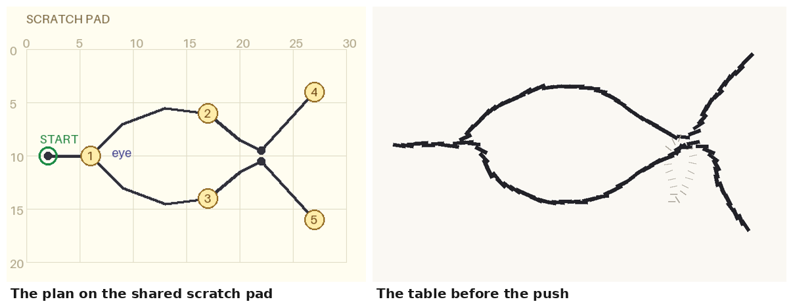
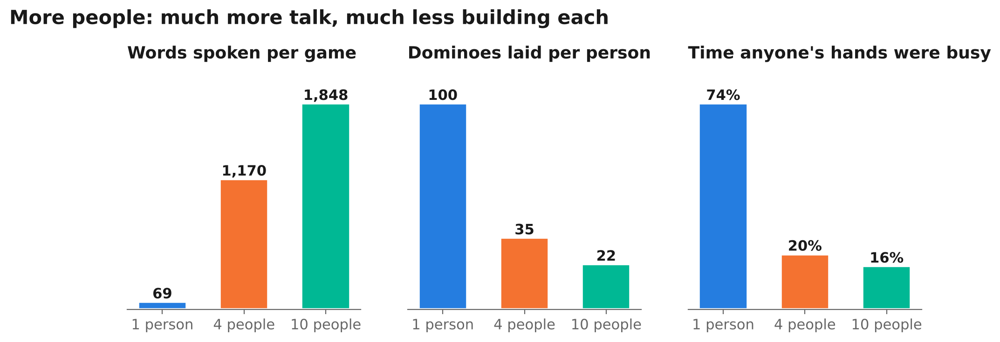
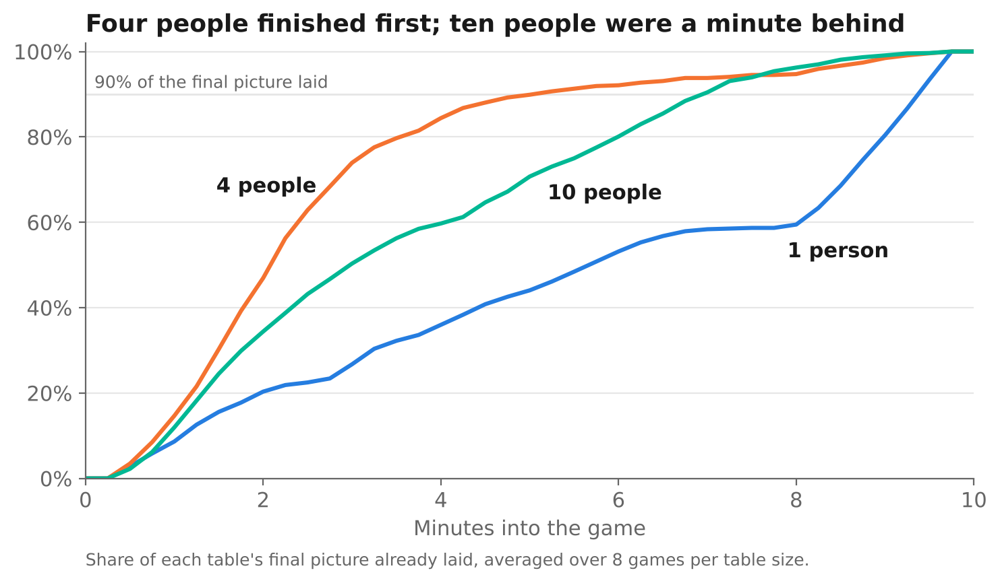
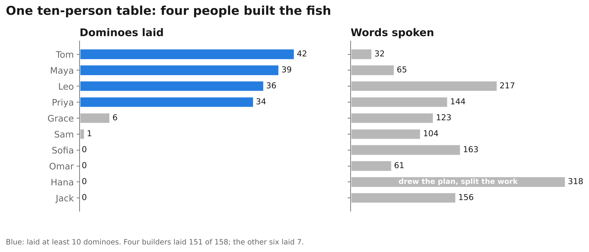
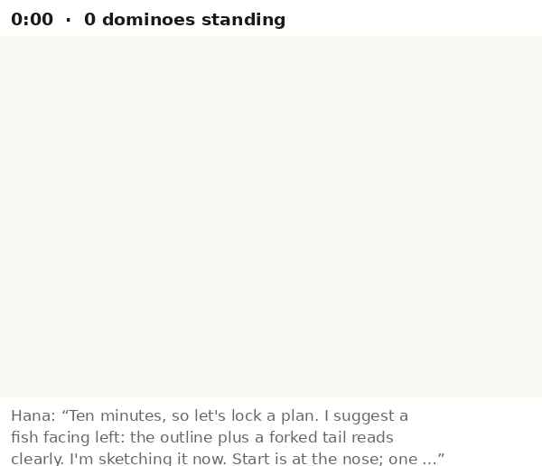
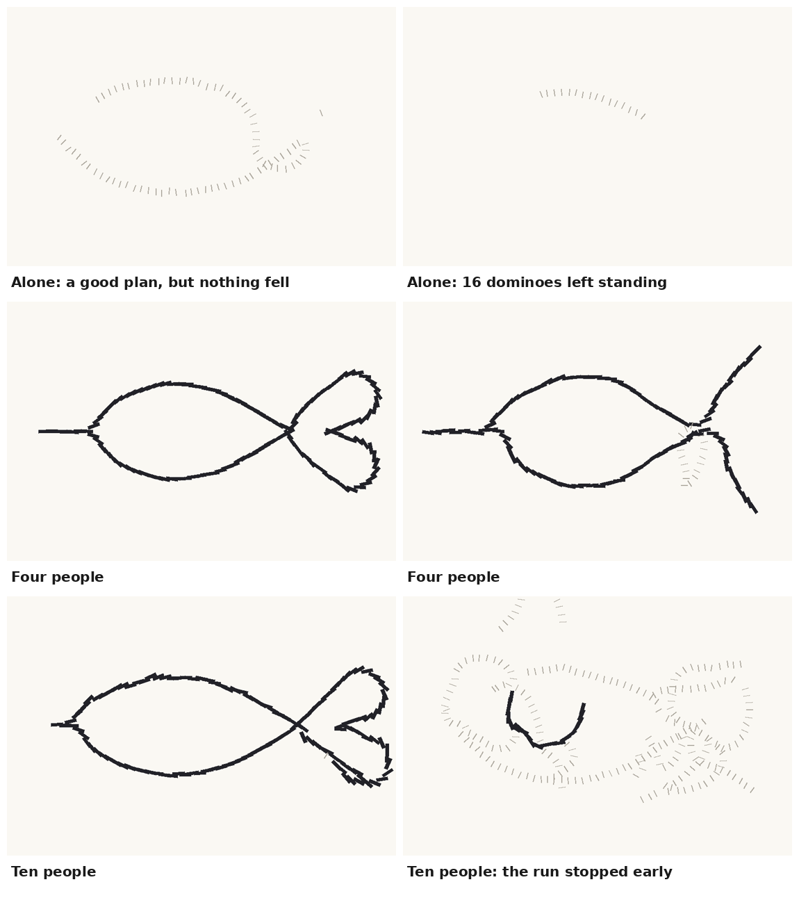

# Experiment 1: Overstaffing (tables of 1, 4 and 10)

**Question.** How does team size change what a team produces, and where does everyone's time go?

**Summary of results** (8 games per table size):

- Four-person tables recognised 8 of 8; ten-person tables 7 of 8; solo players 2 of 8.
- Going from 4 to 10 people raised words spoken by 58% and dominoes laid by 58%. Output per person fell
  37%, and the picture was finished about a minute later.
- At ten, a mean of 3.6 people laid fewer than 10 dominoes. Plans had 3-6 strokes, and the number of
  people who built roughly matched it. The rest inspected and coordinated.
- Solo players failed mainly on execution: breaks they didn't catch, and re-laying their own work until
  time ran out.
- With a smaller model, ten people also degraded the outcome: 47% of standing dominoes fell, against
  81% at four.

---

## 1. Set-up

### 1.1 Task

Each table has **10 minutes** to make a picture of **an animal** of its choice out of dominoes, on a
30 × 20 table with 250 dominoes (1 unit = one domino's height). At 10:00 a facilitator pushes the start
domino. **The picture is what falls**: dominoes still standing are not shown to the judges.

**Judging.** Three blind judges (a separate model call each, no knowledge of the plan) see only an image
of the fallen dominoes and give their top 3 guesses. A judge scores 1 if their first guess names the
team's animal, 0.5 if a later guess does, and 0 otherwise. **Recognition** is the mean over judges; a
game counts as **recognised** at ≥ 0.5. The team's intended animal comes from asking every player at
the end (majority answer).

### 1.2 Simulator

| Component | How it works |
|---|---|
| Players | Language-model agents (same model for all), each with a short personality written as positive traits, e.g. "patient and precise with fiddly work". No titles, no assigned roles. |
| Clock | 15-second beats. A player is asked to decide when something calls for it: being spoken to, its hands finishing a job, a facilitator time call (5 and 2 minutes left), a bump, or at most every 60-120 s. |
| Decisions | Each decision can include something to say (to the table or named people), how eager they are to speak (1-10), where they point, and an action: build, inspect an area, take dominoes down, or carry on. |
| Talk | One speaker at a time per table, limited by a words-per-beat budget. The most eager speaker gets the floor; the others hold their thought and are told so. Talking slows that player's hands. |
| Hands | Each player has a speed (0.6-1.6×) and steadiness (0.5-2.0× placement error), drawn per seed. Average pace is 3 s per domino. |
| Physics | A falling domino knocks the next if it is 0.2-0.9 ahead, within 0.35 to the side, and turned ≤ 40°. Lines can split and merge. A standing domino falls whichever way it is pushed. Working within 3 units of someone can bump the table and topple a run. |
| Scratch pad | One shared pad. Anyone can pick it up and sketch numbered strokes; START marks the run's beginning. Building means tracing a stroke with your own hands. Anchored tools join pieces (connect, extend) or close small breaks (fix). Free-hand aiming is not allowed. |
| Vision | Each decision comes with an image of the table: standing dominoes that the start would knock over are drawn dark, unreached ones pale, plus where people are pointing and working. The pad is a second image. |
| Logging | Every message, decision, domino and pad change is logged. Each game has a replay, a story transcript and pictures. |

*A four-person game. Left: the plan, five numbered strokes from START. Right: the table before the push.*

### 1.3 Conditions

| | Table of 1 | Table of 4 | Table of 10 |
|---|---|---|---|
| Players | one of 8 personalities, rotating | two fixed teams of 4, alternating | all 10 personalities |
| Games | 8 | 8 | 8 |

Everything else is identical across conditions: table, supply, scratch pad, rules text, model, and 10
minutes. Seeds 101-108 set the hand skills and the model's sampling, and are shared across sizes. The
main run uses the larger model ("Sonnet"); §3 repeats the design (4 games per size) with the smaller
model ("Haiku").

### 1.4 Measures

| Measure | Definition |
|---|---|
| Share fell | Dominoes that fell at the push ÷ dominoes standing just before it |
| Picture 50% / 90% laid | First time at which 50% / 90% of the dominoes standing at the end were already on the table |
| Words spoken | All words said aloud at the table |
| Hands busy | Share of player-beats with a build in progress (not waiting for the run to arrive) |
| Laid per person | Dominoes placed (including any later lifted) ÷ players |
| Builders | Players who laid ≥ 10 dominoes |
| Inspections | Close looks at an area (an action that takes the player's hands off building) |
| Rework | Dominoes lifted and re-laid; split into own work and someone else's |

---

## 2. Results

### 2.1 Outcome and time use

| Per game, mean of 8 | 1 person | 4 people | 10 people |
|---|---|---|---|
| Recognised | 2 / 8 | **8 / 8** | 7 / 8 |
| Recognition score | 0.25 | **0.98** | 0.81 |
| Share fell | 56% | **90%** | 76% |
| Picture 50% laid | 5:30 | **2:13** | 3:15 |
| Picture 90% laid | 7:49 | **5:32** | 6:45 |
| Words spoken | 69 | 1,170 | 1,848 |
| Hands busy | 74% | 20% | 16% |
| Dominoes laid (table) | 100 | 139 | 220 |
| Dominoes laid per person | 100 | 35 | 22 |
| Players laying < 10 | 0 | 0.1 | 3.6 |
| Top builder's share | 100% | 37% | 23% |
| Inspections | 0.25 | 20 | 84 |
| Rework: own / others' | 45 / 0 | 2 / 5.5 | 5 / 8.4 |

Every table chose a fish.

The four-person curve leads throughout. Ten-person tables start at the same rate for the first minute,
then fall behind, reaching 90% about 70 seconds later. Solo players build steadily but slowly, and their
curve rises sharply in the last two minutes: much of what stood at the end was laid or re-laid late.

### 2.2 Division of labour at ten

Plans had **3-6 strokes** (median 4.5 at size 10). At ten, **4-8 players** per game laid ≥ 10 dominoes.
The others took up work the game doesn't assign: inspecting, offering to "float" and patch gaps, checking
joins, and directing.

In this game (seed 101), four players laid 151 of the 158 dominoes. The player who drew the plan and
assigned the strokes laid none and spoke the most (318 words). The opening minute shows how the split
formed:

> **Hana:** Ten minutes, so let's lock a plan. I suggest a fish facing left: the outline plus a forked tail
> reads clearly. I'm sketching it now. […] Maya, can you trace stroke 1, the top? Tom, stroke 2, the belly.
> Priya, stroke 3 and Leo, stroke 4, the tail fins.
>
> **Hana:** Pad's ready. […] Sofia, Omar, Jack, Sam and Grace, once the lines are down, watch for gaps and
> bumps and fix them.
>
> **Jack:** Love it Hana, fish it is. I'll back up whoever needs a hand, and I'll check the joints at the tail.
>
> **Omar:** Fish works for me too, Hana, nice sketch. I'll float and cover gaps once the lines are down.

Offers to help were usually turned down rather than taken up:

> **Sofia:** Nose looks solid, everything's connected so far. Priya, Leo, I don't see your hands on the tail
> yet. I'll start on the upper fin, stroke 3.
>
> **Priya:** Thanks Sofia, but I've already got the upper fin queued. It'll start as soon as the top line
> reaches the tail, so no need to double up.

*The same game: one frame per 15 seconds with the longest line said in that beat, then the push
(130 of 131 fell).*

### 2.3 Failure modes

*Before the push. Dark dominoes are connected to the start and fall; pale ones don't.*

| Size | Games not recognised | What went wrong |
|---|---|---|
| 1 | 6 | Unnoticed breaks: one fish was complete but not connected to the start, so nothing fell. Running out of time: up to 80 of their own dominoes lifted and re-laid. |
| 4 | 0 | |
| 10 | 1 | The run broke near the start and only a short arc fell (8% of standing dominoes). Two other games were only partly recognised (0.67, 0.83): a scribbled tail, and a run that broke partway (39% fell). |

Solo players rarely inspected (0.25 inspections per game) and had nobody else looking.

---

## 3. Smaller model

The same design with the smaller model, 4 games per size (seeds 101-104):

| Per game, mean of 4 | 1 person | 4 people | 10 people |
|---|---|---|---|
| Recognised | 0 / 4 | 1 / 4 | 2 / 4 |
| Share fell | 85% | 81% | **47%** |
| Words spoken | 284 | 1,632 | 4,401 |
| Hands busy | 54% | 20% | 11% |
| Dominoes laid per person | 88 | 31 | 17 |
| Rework: others' dominoes | 0 | 0 | 14.5 |
| Inspections | 1.5 | 23 | 74 |

The size effects on talk, hands and output per person are the same as with the larger model. The
difference is in execution at ten: less than half of the standing dominoes fell, and players lifted each
other's work (half of all rework). Recognition was low at every size. At four, the sketches would
mostly have been recognised had everything fallen (0.83), but breaks kept actual recognition at 1 of 4.
Solo and ten-person sketches were often unreadable even then. So this run says more about behaviour than
about outcome.

---

## 4. Interpretation

- **The task's decomposition limits useful headcount.** A fish breaks into about five independent strokes.
  Beyond that, extra players did not add building; they added inspection (4× from 4 to 10 people) and
  talk.
- **Extra players turn into coordination rather than idleness.** Floating, checking, offering help and
  directing all appeared without being asked for. They cost the builders attention and floor time.
- **The first few extra people matter most.** Going from 1 to 4 people fixed the main solo failure
  (unnoticed breaks). Going from 4 to 10 slightly lowered quality and delayed completion.
- **How much overstaffing costs depends on the team.** The stronger model absorbed ten people with a
  small loss. The weaker model collided: rework on others' work and broken runs.

## 5. Limitations

- Players are AI agents. Their deference and politeness may not match people's.
- One task, which decomposes into few parallel pieces. Tasks with more independent parts would likely
  move the optimum up.
- 8 games per size (4 for the smaller model). Differences of a few percentage points are within noise;
  the large effects (words, hands busy, output per person) are consistent across games.
- Bumps (physical crowding) almost never happened, so all the crowding cost here came from talk and
  coordination.
- All tables chose a fish, so the results don't speak to tasks of varying difficulty.

## 6. Reproducing

Code and data: [github.com/lilipads/org-sim](https://github.com/lilipads/org-sim)

- Games: `results/staffing_sonnet/` (larger model) and `results/staffing/` (smaller model). Each game
  folder has `story.md`, `transcript_detailed.md`, `replay.html`, `sketch.png`, `before_push.png`,
  `push.gif` and `summary.json`.
- Runners: `results/staffing_sonnet/run_all.sh` and `run_more.sh`.
- Analysis: `python3 experiments/analyze_staffing.py results/staffing_sonnet`
- Figures: `python3 experiments/writeup_figures.py` (add `gif` for the timelapse)
- One game: `python3 experiments/pilot_live.py --view image --big --model sonnet --names Maya,Tom,Priya,Leo --seed 101 --out results/my_run`

Model calls are cached on disk, so rerunning a seed replays it without new calls.
